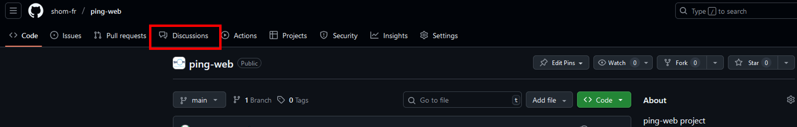
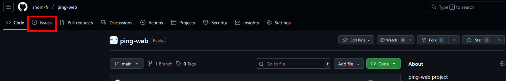
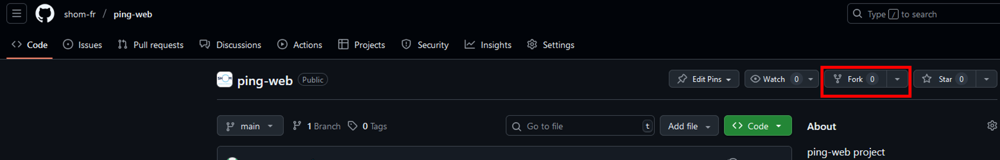

# How to contribute

## Mindset 
This repository is to share code from the Shom’s PING project to the open source community.
Contributions can be of different sorts:
- Sharing ideas of new features
- Sharing new code for new features
- reporting a bug and, if applicable, suggest and share a fix

## Discussion means 
- One can open a discussions topic to share its ideas, ask its questions.

- One can open an issue if the discussion concerns code (already developped or to be developped).
 

## Technically
Only Shom's employees are allowed to modify the repository, however one can contribute by working on a fork of this current repository.
 

### Conventions
Fork the repository and make changes on your fork in a feature branch:
-   If it's a bug fix branch, name it XXXX-something where XXXX is the number of the issue.
-   If it's a feature branch, create an enhancement issue to announce your intentions, and name it XXXX-something where XXXX is the number of the issue.

# Contribution best practice

## Coding Style
## Semantic versioning
https://semver.org/
